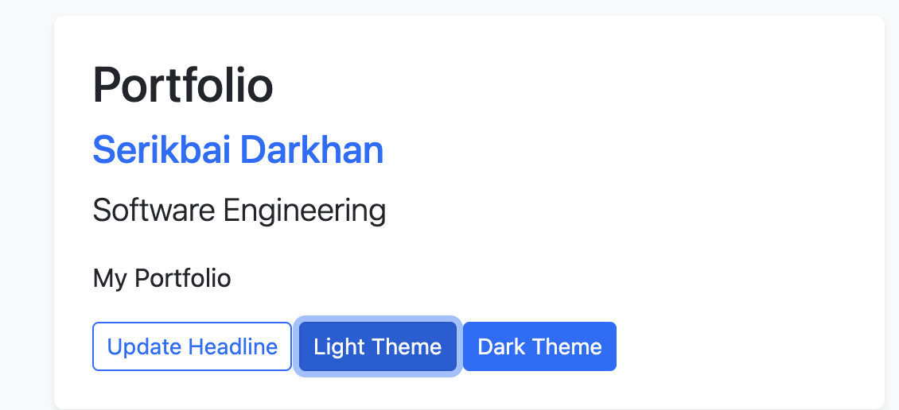
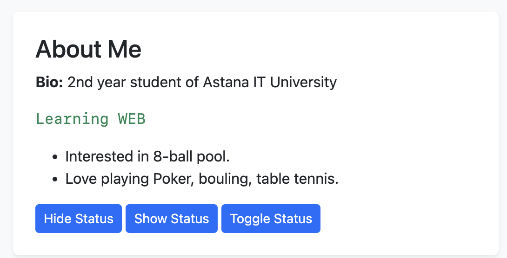
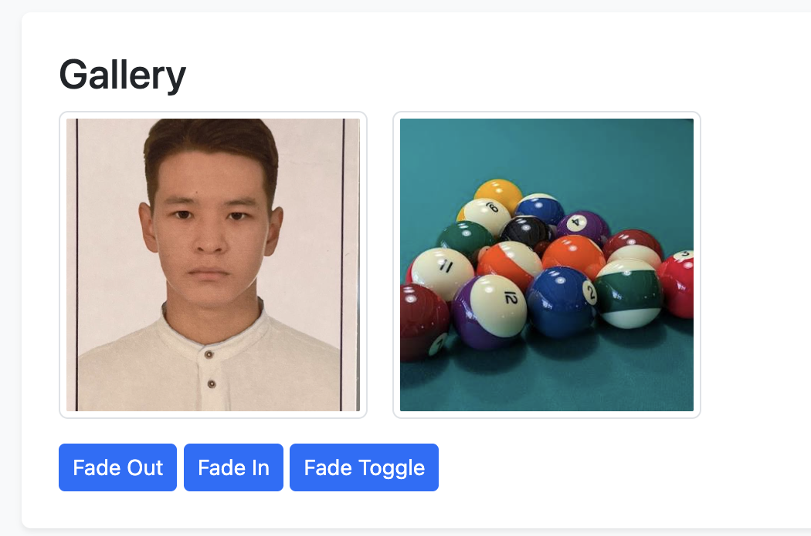
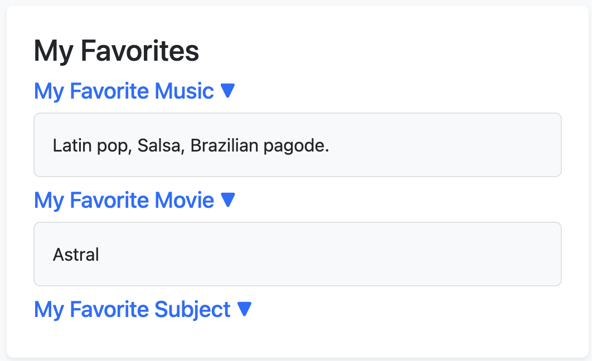
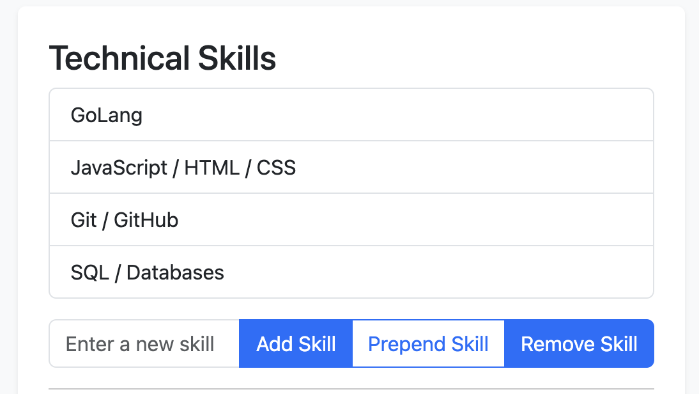
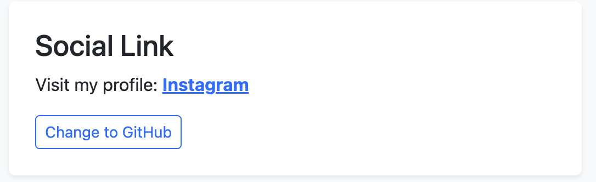
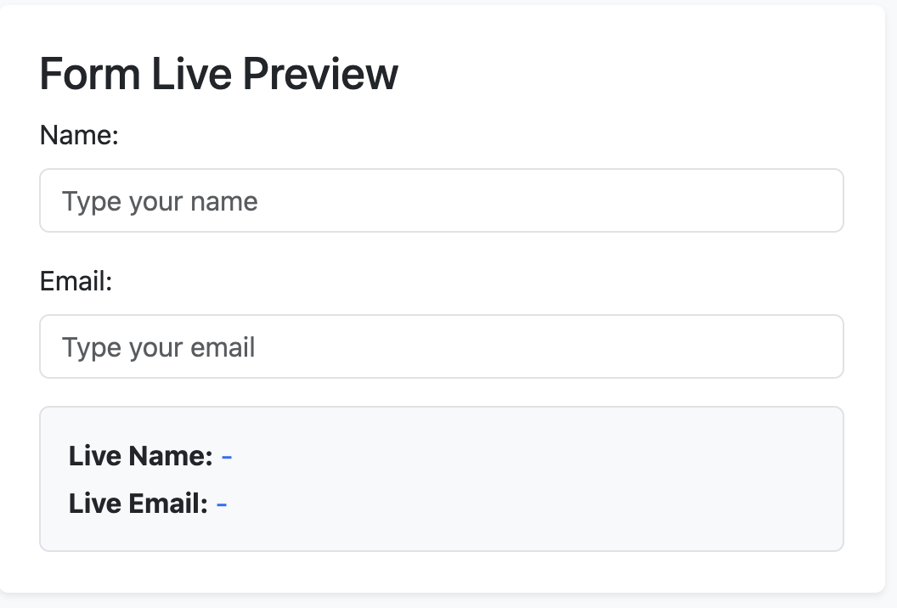
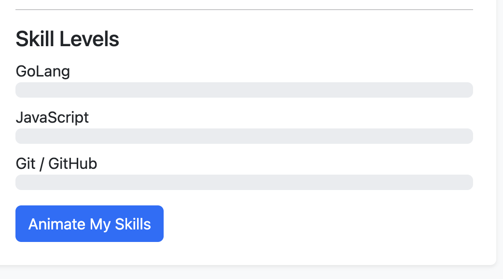

# Assignment #6: jQuery (Selectors, Effects, Animations)

**Student:** Serikbai Darkhan  
**Group:** SE-2540

---

## Work Summary
In this assignment, I built an interactive personal portfolio page using jQuery and Bootstrap. I implemented element selection, CSS dynamic styling, visibility effects (`hide`/`show`/`toggle`), fade and slide animations, dynamic DOM manipulation (adding/removing skills and form input preview), attribute modification, and custom progress bar animations using `.animate()`.

---

## Tasks & Screenshots

### Task 0 & Task 1. Setup, Selectors & CSS
Included jQuery CDN, verified setup in the console, and added dynamic theme switching (Light/Dark mode) with text update features.

---

### Task 2. Visibility Methods
Implemented `Hide`, `Show`, and `Toggle` buttons to control the visibility of the status message.

---

### Task 3. Fade Methods
Created a photo gallery using `.fadeIn()`, `.fadeOut()`, and `.fadeToggle()` effects.

---

### Task 4. Slide Methods
Created clickable accordion headers with collapsible panels using `.slideToggle()`.

---

### Task 5. Add & Remove Elements
Implemented list operations using `.append()`, `.prepend()`, and `.remove()` with input validation for empty strings.

---

### Task 6. Modifying Attributes
Added a button that dynamically updates the `href` attribute and text of the social link using `.attr()`.

---

### Task 7. Form Interaction
Created a form that captures live input values using `.val()` and renders them instantly on the page using `.text()`.

---

### Task 8. Basic Animation (Skill Bars)
Animated skill level progress bars from `0%` to target widths using jQuery's `.animate()` method, with toggle back to `0%` on second click.

# webLAst
